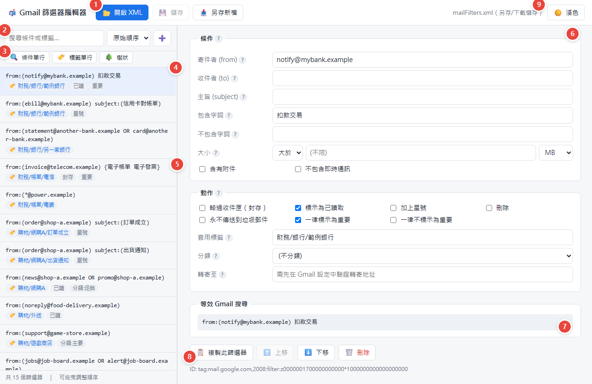
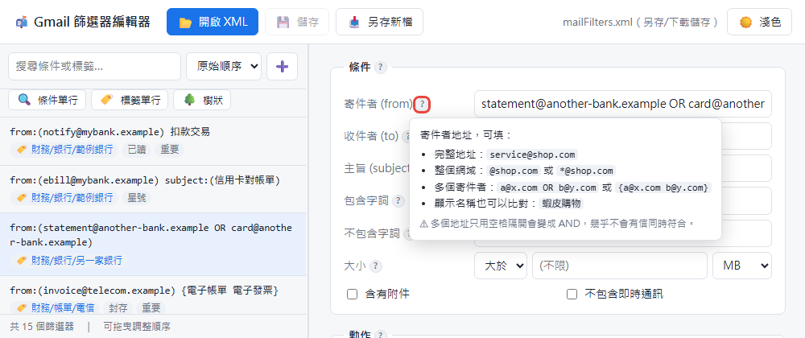
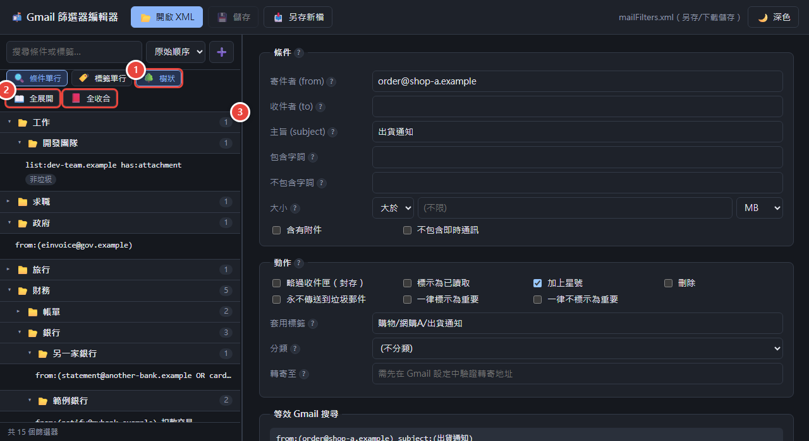
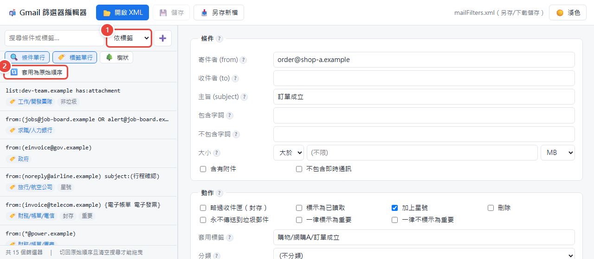

# 📬 Gmail 篩選器編輯器

**👉 線上使用：<https://jordantw9.github.io/gmail-filter-editor/>**

在瀏覽器裡讀取、編輯、另存 Gmail 匯出的篩選器檔案（`mailFilters.xml`）。

整個工具只有一個 `index.html`：不需要安裝任何東西、不用架伺服器。即使用線上版，XML 也只在你的瀏覽器裡處理，不會上傳到任何地方。

## 快速開始

1. 匯出篩選器：Gmail → **設定 → 篩選器和封鎖的地址** → 勾選要匯出的篩選器 → **匯出**，會下載 `mailFilters.xml`。
2. 用 **Chrome 或 Edge** 打開[線上版](https://jordantw9.github.io/gmail-filter-editor/)，或下載 `index.html` 後直接雙擊開啟。
3. 按 **📂 開啟 XML**，或把 XML 拖進視窗。
4. 編輯完按 **💾 儲存**（覆寫原檔）或 **📥 另存新檔**。
5. 匯入回 Gmail：**設定 → 篩選器和封鎖的地址 → 匯入篩選器** → 選擇檔案 → 開啟檔案 → 建立篩選器。

> ⚠ Gmail 匯入只會「新增」篩選器，不會覆蓋。如果要取代舊的設定，請先在 Gmail 把舊篩選器全選刪除再匯入，否則會重複。

建議把篩選器檔案放在 `data/` 資料夾。這個資料夾和所有 `*.xml` 都已經被 `.gitignore` 排除，不會進入版控。

## 操作說明

> 說明圖使用的是虛構範例資料。

### 介面總覽



| # | 區域 | 說明 |
|---|---|---|
| 1 | 檔案 | 📂 開啟 XML、💾 儲存（覆寫原檔）、📥 另存新檔，也可以把 XML 直接拖進視窗 |
| 2 | 搜尋與排序 | 搜尋條件或標籤；切換顯示排序；➕ 新增篩選器 |
| 3 | 顯示切換 | 🔍 條件單行、🏷️ 標籤單行（太長時以 … 省略）、🌳 樹狀模式 |
| 4 | 篩選器清單 | 點選後在右側編輯；在原始順序下可以拖曳調整順序 |
| 5 | 分隔線 | 拖動調整左右寬度，雙擊還原 |
| 6 | 條件與動作 | 編輯篩選器內容，欄位旁的 **?** 有語法說明 |
| 7 | 等效 Gmail 搜尋 | 即時顯示對應的搜尋語法，可以貼到 Gmail 搜尋列驗證 |
| 8 | 篩選器操作 | 📋 複製、⬆️ 上移、⬇️ 下移、🗑️ 刪除 |
| 9 | 主題 | 🖥️ 自動 → ☀️ 淺色 → 🌙 深色 |

### 欄位語法提示

滑鼠移到欄位旁的 **?** 上，會顯示該欄位的寫法和範例。



### 樹狀模式

① 開啟 🌳 樹狀，篩選器會依標籤的 `/` 分層顯示。② 用 📖 全展開、📕 全收合一次切換全部資料夾。③ 點資料夾可以個別展開或收合，右側數字是底下的篩選器數量。



### 排序並寫回檔案

① 把顯示排序切到「依標籤」或「依寄件者」。② 按 🔃 **套用為原始順序**，所有篩選器會依這個方式重新排列，存檔後寫入 XML。



想要手動調整順序時，切回「原始順序」並清空搜尋，就可以直接拖曳清單項目。

## 功能

### 編輯
- 支援 Gmail 篩選器的所有條件（寄件者、收件者、主旨、包含／不包含字詞、大小、附件）和所有動作（標籤、封存、已讀、星號、刪除、重要性、分類、轉寄）。
- 每個欄位旁的 **?** 會顯示填寫語法，例如 OR／AND、排除、片語、跨欄位組合。
- 即時顯示對應的 Gmail 搜尋語法，可以貼到 Gmail 搜尋列先驗證結果。
- 新增、複製、刪除篩選器；標籤欄位會自動完成已存在的標籤名稱。
- 工具不認得的屬性會原樣保留，存檔時不會遺失。

### 瀏覽與排序
- 搜尋：比對條件和標籤。
- 顯示排序：原始順序、依標籤、依寄件者。
- **🔃 套用為原始順序**：把目前的顯示排序寫入檔案順序。
- 手動排序：在「原始順序」而且沒有搜尋時，可以直接拖曳清單項目，或用 ⬆️ ⬇️ 移動。
- **🌳 樹狀模式**：依標籤的 `/` 分層，資料夾可收合，並提供 📖 全展開、📕 全收合。
- **🔍 條件單行**、**🏷️ 標籤單行**：內容太長時以 … 省略，讓清單更精簡。

### 介面
- 左右兩欄的分隔線可以拖動調整寬度，雙擊還原。
- 主題切換：🖥️ 自動（跟隨系統）→ ☀️ 淺色 → 🌙 深色。
- 側欄寬度、單行、樹狀收合狀態、主題等偏好會記在瀏覽器的 localStorage。
- 快捷鍵：`Ctrl+O` 開啟、`Ctrl+S` 儲存、`Ctrl+Shift+S` 另存新檔。
- 有未儲存的變更時，關閉頁面或開啟其他檔案前會先詢問。

## 瀏覽器支援

| 環境 | 開啟 | 儲存 |
|---|---|---|
| Chrome / Edge（線上版或本機開啟） | 原生檔案選擇器 | 直接覆寫原檔 |
| Firefox / Safari | 一般檔案選擇 | 以下載方式另存 |
| VS Code 內嵌預覽（iframe） | 一般檔案選擇 | 以下載方式另存 |

## Gmail 篩選器語法速查

| 需求 | 寫法 |
|---|---|
| 多個寄件者（OR） | `a@x.com OR b@y.com` 或 `{a@x.com b@y.com}`（OR 必須大寫） |
| 整個網域 | `@shop.com`（`*` 只能放開頭，例如 `*@shop.com`；`ecimail*` 這種中間萬用字元不支援） |
| 同時包含（AND） | 空格隔開：`出貨 通知` |
| 排除 | `-取消` |
| 完整片語 | `"出貨通知"` |
| 跨欄位組合 | 寫在「包含字詞」：`{(from:a 扣款) (from:b 轉帳)}` |

- 有填的欄位之間是 **AND**。
- 同一封信符合多個篩選器時，**全部**都會執行。
- `label:`、`in:`、`is:`、`older_than:` 這類看信件目前狀態的運算子，對新進信件通常不會生效。

## 專案結構

```
index.html    編輯器本體（HTML + CSS + JS，無外部相依）
README.md
.gitignore    排除 *.xml 與 data/
docs/images/  README 用的說明圖（虛構範例資料）
data/         放篩選器 XML（不進版控）
```
